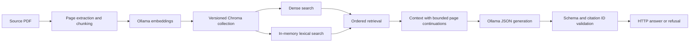

# Architecture

The service has one process, one active source document and one embedded Chroma
index. Experimental ARAGOG, CRAG and conversational memory modules are outside the
release tree; they are not required by the baseline.

## Ingestion and index lifecycle

`utc-ingest` extracts PDF pages using pypdf, with pdftotext as a fallback. Plain
UTF-8 text is also supported when explicitly configured. Chunks retain the document
filename, source path, one-based PDF page, estimated printed page, heading and a
deterministic chunk ID. Default chunk size/overlap is 600/100 characters.

A writer lock permits one ingestion. A rebuild writes a new collection, checks its
count and the source hash, then publishes a flushed manifest with an atomic replace.
Failures preserve the previously published collection and manifest. A crash can
leave an unpublished collection. Old generations remain until the operator cleans
them up after backup; see [operations](operations.md).

Readers never ingest. Missing, legacy, incomplete or incompatible indexes fail
closed. The manifest binds the active collection, embedding model, source hash,
chunk settings and count. Source bytes must match before serving. After ingestion,
restart the API: an already open reader retains its previous collection, and
readiness rejects a mismatch with the newly published manifest.

## Retrieval and generation

The measured baseline combines the first three dense results with the first two
lexical results, removes duplicate chunk IDs, then fills remaining slots from both
lists. The default is five primary chunks. Up to two adjacent chunks are added
when a bullet list continues onto the next PDF page. Retrieval metrics score the
original candidates; generation sees the expanded context.

The Vietnamese prompt, `qwen3.5:9b-q4_K_M`, `qwen3-embedding:0.6b`, temperature 0,
8,192-token context, disabled reasoning and 768-token output limit retain the
qualified baseline settings. Estimated headings are excluded from prompt labels.
The model must return JSON containing an answer, citation IDs and a refusal flag.

Schema errors, invented citation IDs, empty answers or missing citations become
operational errors. A refusal has no citations. Validation proves that IDs came
from context; it does not prove that every statement follows from the excerpts.

## HTTP boundary and failure paths

Startup loads one engine. Trusted Host and explicit browser-origin checks protect
the loopback API; CORS handles permitted preflights before bearer authentication.
The request body, question length and retrieval count are bounded. A semaphore
permits one inference, with a process-wide limit of 30 requests per minute.

`/health` reports process liveness. `/ready` checks model availability and active
index/source consistency. Model/index failures produce 503, busy/rate-limited
requests produce 429, and valid out-of-scope questions produce a 200 refusal.
See [API](api.md) for the full response contract.
